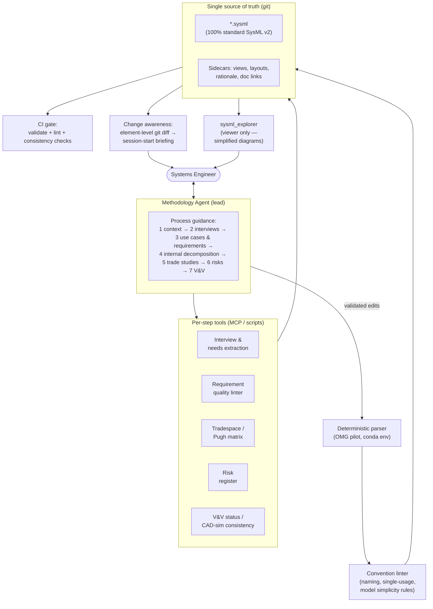

# SE Assistant — Architecture and Next Steps

AI-powered Systems Engineering assistant for small/medium organizations.
This file captures the agreed direction (2026-07-25) so it survives between
sessions. See `TODO.md` for tool-level tasks.

## Principles

1. **The SysML v2 textual model in git is the single source of truth.**
   Model files stay 100% standard SysML v2 — no custom dialect. Anything
   extra (views, layouts, links to docs/pictures, rationale) lives in
   sidecar files next to the model.
2. **`sysml_explorer` is a viewer only.** Its job is simplifying the
   graphical notation — curated views, manual placement, drill-down — so
   non-modelers can read the model. It is *not* a model API or a modeling
   platform, and never edits the model.
3. **A deterministic parser guards model validity.** The official OMG pilot
   parser validates every change — interactively while the agent works, and
   again in CI on every commit. The agent never relies on its own idea of
   what is valid SysML.
4. **Few agents, many tools.** One Methodology Agent leads the process;
   each methodology step is supported by dedicated tools/scripts the agent
   can call (MCP tools, skills, plain scripts). A new agent is only added
   when a role needs its own context or autonomy.
5. **Deterministic where it matters.** Validation, traceability queries,
   diffs, and impact analysis are computed by tools; the LLM only decides
   and narrates.
6. **Complexity is limited at both levels.** `sysml_explorer` limits
   *presentation* complexity (simplified diagrams); a convention linter
   limits *model* complexity by enforcing a house modeling style on top of
   raw syntax validity (see "Convention linter" below). Legal SysML is not
   automatically acceptable SysML.

## Components

### Methodology Agent (lead)
Guides the systems engineer through the process in the right order and
keeps track of where the project stands. Typical flow:

1. Stakeholder & context analysis → context model/diagram
2. Stakeholder interviews → transcript analysis → needs
3. Use cases and requirements
4. Internal decomposition (logical → physical architecture)
5. Solution alternatives → trade-space exploration (Pugh matrix, tradespace scripts)
6. Risk analysis
7. Verification & validation

At each step it enforces exit criteria ("3 stakeholders have no needs
captured — interview or de-scope before moving on") and calls the
step-specific tools below.

### Per-step tools (agent-accessible)
Each methodology step gets one or more tools/scripts, exposed to the agent
(MCP or CLI). Examples: interview-guide generator, transcript → needs
extractor, requirement quality linter, Pugh matrix / tradespace runner
(seed: `examples/RoboticArm/1_SystemModel/Tradespace exploration`),
risk-register maintenance, verification-status report, parameter-consistency
check against CAD/simulation (seed: `Traceability/test_link_lengths_traceability.py`).

### Deterministic parser & CI gate
The OMG pilot parser (conda env `sysml`) is the conformance authority:

- **While editing:** every model change is validated immediately (hook after
  each `.sysml` edit; later, structured edit operations that validate
  *before* writing).
- **In CI / pre-commit:** full-model validation plus consistency checks —
  unresolved references, requirements without satisfy links, stale views.

### Convention linter (model style guard)
Runs alongside the parser in the same places (edit hook, CI). The parser
checks *validity*; the linter checks *simplicity and consistency* — the
model-level counterpart of the explorer's diagram simplification. Initial
rules:

- Definitions are UpperCamelCase (`Engine`, `Vehicle`, `PowerSupply`).
- Usages are lowerCamelCase (`engine`, `vehicle`, `powerSupply`).
- If a definition has exactly one usage, the usage must be named exactly
  after it (`part engine : Engine`) — no gratuitous renaming.

The rule set is meant to grow (e.g. limits on nesting depth, one top-level
definition per file, required doc comments on requirements). Rules are
deterministic checks, each with an ID, so violations can be reported in CI,
surfaced to the coding agent, and suppressed case-by-case with a recorded
justification when a rule genuinely shouldn't apply.

### sysml_explorer (viewer)
Read-only visualization of the model: simplified diagrams, manual layout,
views saved as sidecars and validated against the model.

### Change awareness (later phase)
Because everything is text in git: on session start, diff the model since
the user's last-seen commit at the *element* level (parse both revisions,
compare graphs), and brief the user — what changed, why (from commit
rationale), which of their artifacts are affected.

## Diagram

## Next steps (in order)

1. **Migrate the model dialect to pure standard SysML v2** (drop `ibd def`
   / `use case useDiagram` forms; use `connect` + `view def`/`view`).
   Cheapest now, expensive later. (Already top of `TODO.md`.)
2. **Stage 1 — validation hook:** after any `.sysml` edit by the coding
   agent, automatically run the pilot parser and feed errors back. Direct
   edits stay allowed, but a syntax break can never go unnoticed.
3. **Convention linter v1:** deterministic style checks — def/usage case
   rules, single-usage-named-after-def — wired into the same hook and CI
   as the parser. Grows rule-by-rule from there.
4. **CI validation:** run parser + linter + consistency checks (unresolved
   refs, trace gaps, stale views) on every commit/PR.
5. **Methodology Agent v1:** encode one methodology as skills/checklists
   with process state tracked in a project file; wire in the first
   per-step tools (requirements linter, tradespace runner).
6. **Stage 2 — structured edits:** small write-side MCP server
   (add element / add relationship / rename with reference updates) that
   validates *before* writing; block direct `.sysml` edits for covered
   operations. Read/query side: reuse the JamieD (`daltskin/sysml-v2-lsp`)
   MCP server rather than building one.
7. **Change-awareness briefing** at session start (element-level diff +
   rationale from commit messages).
8. **Later / optional:** stand up the pilot `SysML-v2-API-Services` server
   as a *derived read-only index* (republished from git by CI) only when a
   second consumer needs to query the live model via the standard API.
   Git files remain the truth; the API server is never written to directly.

## Open-source building blocks (evaluated 2026-07)

- `daltskin/sysml-v2-lsp` — LSP + MCP server on local files (read/query/
  validate); already wrapped by `tools/sysml_jamied_mcp.cmd`.
- `redsteve/SysML-v2-API-MCP-Server` — MCP client for the standard SysML v2
  API (needs an API server running).
- `Open-MBEE/sysmod-sysmlv2-api` — methodology-aware (SYSMOD) API + MCP;
  prior art for the Methodology Agent idea.
- `Systems-Modeling/SysML-v2-API-Services` — pilot standard-API server
  (Play/Java/Postgres); heavyweight, no textual-notation ingest — see
  step 8 for its only intended role here.
