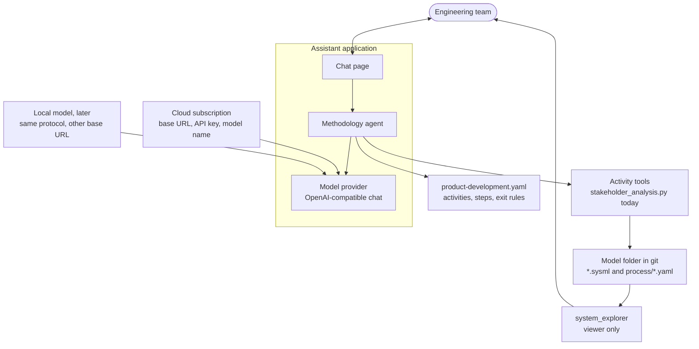

# SE Assistant — Architecture and Next Steps

AI-powered Systems Engineering assistant for small/medium organizations.
This file captures the agreed direction (2026-07-25) so it survives between
sessions. See `TODO.md` for tool-level tasks.

## Principles

1. **The SysML v2 textual model in git is the single source of truth.**
   Model files stay 100% standard SysML v2 — no custom dialect. Anything
   extra (views, layouts, links to docs/pictures, rationale) lives in
   sidecar files next to the model.
2. **`system_explorer` is a viewer only.** Its job is simplifying the
   graphical notation — curated views, manual placement, drill-down — so
   non-modelers can read the model. It is *not* a model API or a modeling
   platform, and never edits the model.
3. **A deterministic parser guards model validity.** The official OMG pilot
   parser validates every change — interactively while the agent works, and
   again in CI on every commit. The agent never relies on its own idea of
   what is valid SysML.
4. **Few agents, many tools.** One Methodology Agent leads the process;
   each methodology step is supported by dedicated tools/scripts the agent
   can call (MCP tools, skills, plain scripts). A new agent is only added
   when a role needs its own context or autonomy.
5. **Deterministic where it matters.** Validation, traceability queries,
   diffs, and impact analysis are computed by tools; the LLM only decides
   and narrates.
6. **Complexity is limited at both levels.** `system_explorer` limits
   *presentation* complexity (simplified diagrams); a convention linter
   limits *model* complexity by enforcing a house modeling style on top of
   raw syntax validity (see "Convention linter" below). Legal SysML is not
   automatically acceptable SysML.

## Components

### Methodology Agent (lead)
Guides the systems engineer through the process in the right order and
keeps track of where the project stands. Typical flow:

1. Stakeholder & context analysis → context model/diagram
2. Stakeholder interviews → transcript analysis → needs
3. Use cases and requirements
4. Internal decomposition (logical → physical architecture)
5. Solution alternatives → trade-space exploration (Pugh matrix, tradespace scripts)
6. Risk analysis
7. Verification & validation

At each step it enforces exit criteria ("3 stakeholders have no needs
captured — interview or de-scope before moving on") and calls the
step-specific tools below.

### Per-step tools (agent-accessible)
Each methodology step gets one or more tools/scripts, exposed to the agent
(MCP or CLI). Examples: interview-guide generator, transcript → needs
extractor, requirement quality linter, Pugh matrix / tradespace runner
(seed: the tradespace scripts in the separate RoboticArm_example repo),
risk-register maintenance, verification-status report, parameter-consistency
check against CAD/simulation (seed: the RoboticArm example's
`Traceability/test_link_lengths_traceability.py`, in this repo's git history
before the examples moved out).

### Deterministic parser & CI gate
The OMG pilot parser (conda env `sysml`) is the conformance authority:

- **While editing:** every model change is validated immediately (hook after
  each `.sysml` edit; later, structured edit operations that validate
  *before* writing).
- **In CI / pre-commit:** full-model validation plus consistency checks —
  unresolved references, requirements without satisfy links, stale views.

### Convention linter (model style guard)
Runs alongside the parser in the same places (edit hook, CI). The parser
checks *validity*; the linter checks *simplicity and consistency* — the
model-level counterpart of the explorer's diagram simplification. Initial
rules:

- Definitions are UpperCamelCase (`Engine`, `Vehicle`, `PowerSupply`).
- Usages are lowerCamelCase (`engine`, `vehicle`, `powerSupply`).
- If a definition has exactly one usage, the usage must be named exactly
  after it (`part engine : Engine`) — no gratuitous renaming.

The rule set is meant to grow (e.g. limits on nesting depth, one top-level
definition per file, required doc comments on requirements). Rules are
deterministic checks, each with an ID, so violations can be reported in CI,
surfaced to the coding agent, and suppressed case-by-case with a recorded
justification when a rule genuinely shouldn't apply.

### system_explorer (viewer)
Read-only visualization of the model: simplified diagrams, manual layout,
views saved as sidecars and validated against the model.

### Change awareness (later phase)
Because everything is text in git: on session start, diff the model since
the user's last-seen commit at the *element* level (parse both revisions,
compare graphs), and brief the user — what changed, why (from commit
rationale), which of their artifacts are affected.

## Diagram

## Assistant and viewer

The engineering team uses two local pages. The assistant is a separate
application from `system_explorer`. The explorer keeps reading the model
folder and drawing it. The assistant is the only process that talks to a
language model, asks the team what to do next, and runs the activity
tools that write the folder. A cloud subscription and a future local
model are two settings of that assistant, using the same chat protocol.

### Why a separate application

The explorer's job is the diagram. It stays free of API keys, chat
transcripts, and model writes, including when a folder is published as a
static viewer. The assistant owns the conversation and the credentials.
Both live in this repo and share the model folder on disk. Locally the
team opens the chat on one port and the explorer on another; the chat
page links to the explorer rather than embedding it.

Putting the chat inside `viewer.html` would make the viewer a modeling
tool and would tie every future model change to the diagram page. A
second repository would split the methodology file from the tool that
implements it.

### Model provider

One client function, `complete(messages) -> text`, speaks the OpenAI
chat-completions protocol. Cloud subscriptions that expose that protocol
(OpenAI, Azure OpenAI, OpenRouter, and others) and local servers that
expose it (Ollama, LM Studio) differ only by configuration:

| Variable | Cloud subscription | Local model, later |
| --- | --- | --- |
| `ASSISTANT_BASE_URL` | the provider's `/v1` URL | `http://127.0.0.1:11434/v1` (Ollama) or the local server's equivalent |
| `ASSISTANT_API_KEY` | the subscription key | empty when the local server does not use one |
| `ASSISTANT_MODEL` | the subscribed model name | the local model name |
| `MODEL_FOLDER` | the folder `system-explorer` is showing | the same |
| `EXPLORER_URL` | `http://127.0.0.1:8199/` | the same |

The key stays in the assistant process. The explorer never receives it.
Changing provider is a change of these variables, not a change to the
chat page, the methodology file, or the activity tools.

### What the model is allowed to do

The model asks, explains, and chooses the next question. It does not
write `.sysml` itself. A turn runs like this:

1. Load `process/state.yaml`. A new folder gets the opening question:
   what the project is, and whether the team already has documents or is
   at the beginning. A folder with an open activity continues that
   activity instead of greeting again.
2. Send the methodology entry, the state, and the transcript to the
   provider.
3. When the model asks for a tool, the server runs only the activity
   tools named in the methodology file (`check` and `apply` for
   stakeholder analysis). The model receives the tool's text report.
4. `apply` writes the register, the SysML, and the state. The team
   refreshes the explorer, or follows the link, to see the diagram.

Documents the team wants to share go in the model folder. The assistant
may read them and propose register rows. `apply` runs after the team
confirms the proposal.

### Implementation plan

1. **Provider client.** Implement `complete(messages)` behind the
   variables above, with no web page. A single CLI turn must work
   against a cloud key, and the same call must work later against a
   local base URL.
2. **Tool loop.** Let the model request `check` and `apply` for
   stakeholder analysis. The server executes those commands in
   `MODEL_FOLDER` and returns their output. Reject any other command.
3. **Local chat page.** A small page on its own port: the transcript,
   one text box, and a link to `EXPLORER_URL`. The first turn is the
   fixed greeting. The page stores the transcript for the session only.
4. **State on return.** At the start of a session, read
   `process/state.yaml` and continue an open activity. Skip the greeting
   when a step is already underway.
5. **Shared documents.** Accept files dropped into the model folder,
   quote the parts that support a proposed stakeholder or need, and wait
   for confirmation before `apply`.
6. **Further activities.** Each new row in `product-development.yaml`
   brings one tool and the same loop. The provider client and the chat
   page stay as they are.

*Status 2026-11-21:* steps 1–4 are the `assistant` package (`python -m assistant`).
The provider speaks OpenAI chat completions, including tool calls.
`ASSISTANT_AUTH=api-key` covers subscriptions that do not use a bearer
token. Step 5 reads `.txt`, `.md`, and `.csv` files already in the model
folder; PDFs are listed and not parsed. The model may call
`stakeholder_check` and `stakeholder_apply`. `apply` writes the register
the team confirmed, then the SysML.

## Next steps (in order)

1. **Migrate the model dialect to pure standard SysML v2** (drop `ibd def`
   / `use case useDiagram` forms; use `connect` + `view def`/`view`).
   Cheapest now, expensive later. (Already top of `TODO.md`.)
   *Status 2026-11:* the explorer no longer parses either form and the
   CoolSpine example no longer uses them; still to do is getting the
   official parser green on the example.
2. **Stage 1 — validation hook:** after any `.sysml` edit by the coding
   agent, automatically run the pilot parser and feed errors back. Direct
   edits stay allowed, but a syntax break can never go unnoticed.
3. **Convention linter v1:** deterministic style checks — def/usage case
   rules, single-usage-named-after-def — wired into the same hook and CI
   as the parser. Grows rule-by-rule from there.
4. **CI validation:** run parser + linter + consistency checks (unresolved
   refs, trace gaps, stale views) on every commit/PR.
5. **Methodology Agent v1:** encode one methodology as a YAML checklist
   with process state in the model folder. The first activity is
   stakeholder analysis (`methodology/product-development.yaml`,
   `methodology/stakeholder_analysis.py`): a register of stakeholders,
   at least one user need each, categorized as customer, internal, or
   regulatory, written out as standard SysML v2. Later activities
   (requirements linter, tradespace runner) follow the same shape.
   The chatbot that drives this file is a separate application; the
   plan and the provider settings are under "Assistant and viewer".
6. **Stage 2 — structured edits:** small write-side MCP server
   (add element / add relationship / rename with reference updates) that
   validates *before* writing; block direct `.sysml` edits for covered
   operations. Read/query side: reuse the JamieD (`daltskin/sysml-v2-lsp`)
   MCP server rather than building one.
7. **Change-awareness briefing** at session start (element-level diff +
   rationale from commit messages).
8. **Later / optional:** stand up the pilot `SysML-v2-API-Services` server
   as a *derived read-only index* (republished from git by CI) only when a
   second consumer needs to query the live model via the standard API.
   Git files remain the truth; the API server is never written to directly.

## Open-source building blocks (evaluated 2026-07)

- `daltskin/sysml-v2-lsp` — LSP + MCP server on local files (read/query/
  validate); already driven by `python -m system_explorer.jamied_check`.
- `redsteve/SysML-v2-API-MCP-Server` — MCP client for the standard SysML v2
  API (needs an API server running).
- `Open-MBEE/sysmod-sysmlv2-api` — methodology-aware (SYSMOD) API + MCP;
  prior art for the Methodology Agent idea.
- `Systems-Modeling/SysML-v2-API-Services` — pilot standard-API server
  (Play/Java/Postgres); heavyweight, no textual-notation ingest — see
  step 8 for its only intended role here.
