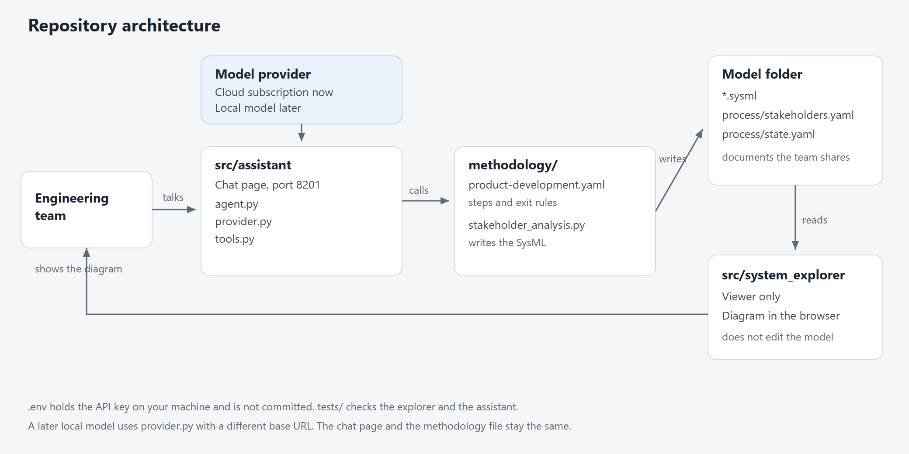

# SE assistant

Local chat for a small engineering team. It asks what the project is, walks through stakeholder analysis, and writes a standard SysML v2 model. [System Explorer](../../README.md) only draws that model.



## Run

From the repository root, copy [`.env.example`](../../.env.example) to `.env` and set:

```
ASSISTANT_BASE_URL=https://parley.api.mit.edu/v1
ASSISTANT_API_KEY=
ASSISTANT_MODEL=claude-haiku-4-5
MODEL_FOLDER=c:\sources\SE_assistant\local-model
EXPLORER_URL=http://127.0.0.1:8202/
```

Put the key only in `.env`. That file is gitignored.

```
python -m assistant
```

Open http://127.0.0.1:8201/ . In another terminal, show the same folder:

```
python -m system_explorer local-model --port 8202 --no-open
```

**Open the diagram** on the chat page uses `EXPLORER_URL`. Any other OpenAI-compatible endpoint works with the same variables. A local model later is a different `ASSISTANT_BASE_URL` (for example `http://127.0.0.1:11434/v1`) and an empty key. Subscriptions that want an `api-key` header set `ASSISTANT_AUTH=api-key`.

## A session

A new folder starts with: what the project is, and whether the team already has documents or is at the beginning. The assistant then collects stakeholders, a category (`customer`, `internal`, or `regulatory`), and at least one user need each. After the team confirms the list, it writes `process/stakeholders.yaml`, `stakeholders.sysml`, and `user_needs.sysml`. Refresh the explorer to see them.

Text files (`.txt`, `.md`, `.csv`) dropped in the model folder are read. PDFs are listed and not parsed. An open `process/state.yaml` continues that activity instead of greeting again.

One turn from the terminal, without the page:

```
python -m assistant say "We are at the beginning. The product is a portable infusion pump."
```

## Files in this folder

| File | Role |
| --- | --- |
| `server.py` | Local page on port 8201 |
| `agent.py` | Greeting, prompt, and tool loop |
| `provider.py` | Chat request to the configured model |
| `tools.py` | `stakeholder_check` and `stakeholder_apply` only |
| `chat.html` | The page the team uses |
| `architecture.png` | The picture above |
| `architecture.svg` | The same drawing, for editing |
